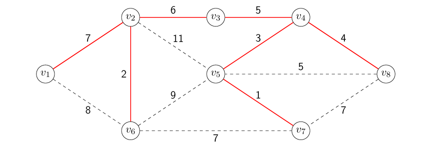
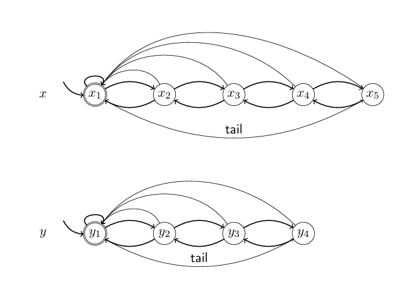
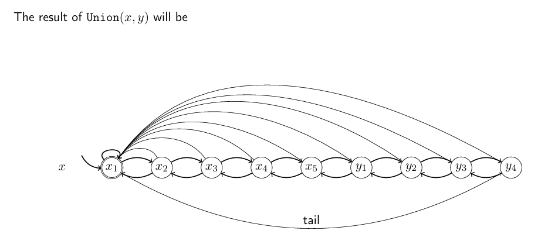
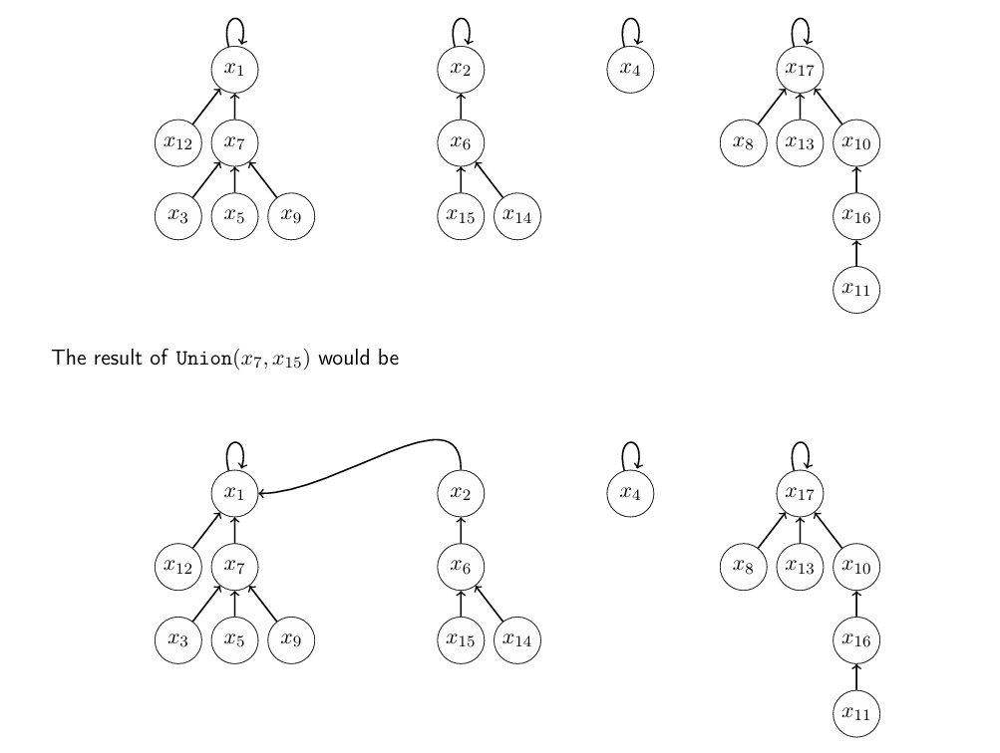
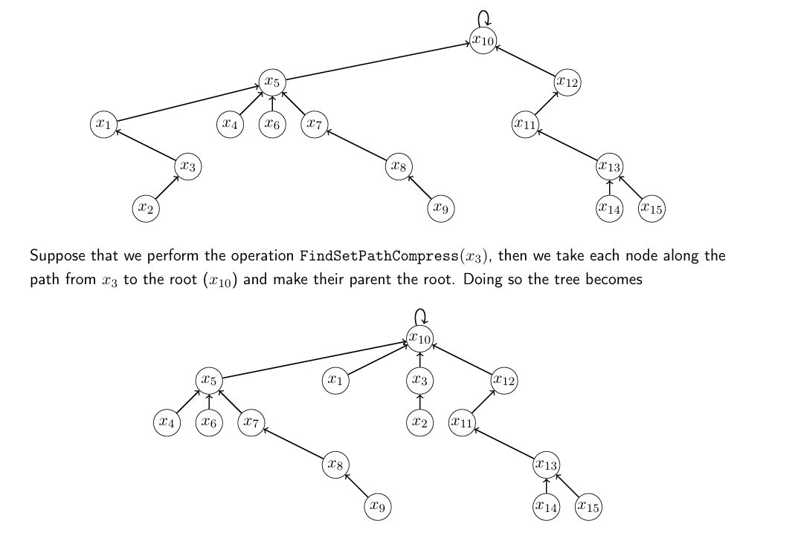

# Graph Algorithms, Greedy Graph Algorithms and Union Find

**Author:** Eric Zhou  
**Email:** <eric_ds_zhou@outlook.com>  
**Date:** Nov 07, 2026

## Introduction

This technical note summarizes the fundamental concepts, algorithms, and data structures used in graph algorithms, with a particular focus on greedy algorithms and Union-Find.

The note covers graph representations, minimum spanning trees, shortest paths, and Union-Find implementations. It also discusses the correctness of greedy algorithms through mathematical theorems and analyzes the time complexity of different implementations.

## Table of Contents

- Graph Algorithms
  - Basic Graph Concepts
  - Graph Representations
    - Adjacency Matrix
    - Adjacency List
  - Graph Properties and Lemmas
  - Algorithm Analysis
    - Basic Graph Traversal
    - Graph Algorithms with Priority Queue
- Minimum Spanning Tree (MST)
  - Definition
  - Prim's Algorithm
  - Kruskal's Algorithm
  - Lemmas and Theorems
  - Examples
  - Implementation and Complexity Analysis
- Shortest Paths
  - Definition
  - Shortest Path Theorems
  - Dijkstra's Algorithm
  - Examples
  - Implementation and Complexity Analysis
- Union-Find
  - Definition and Operations
  - Linked List Union-Find
    - Weighted Union
  - Tree-Based Union-Find
    - Weighted Union
    - Path Compression
  - Complexity Analysis
- Reference List

## Graph Algorithms

### Basic Graph Concepts

A **graph** is a fundamental data structure consisting of a set of vertices and a set of edges. A graph is typically represented as:

$$
G = (V, E)
$$

where:

- $V$: The set of vertices (nodes).
- $E$: The set of edges connecting vertices.
- $|V| = n$: The number of vertices.
- $|E| = m$: The number of edges.
- $G.V$: The vertex set of graph $G$.
- $G.E$: The edge set of graph $G$.

**Important Definitions:**

- **Adjacent:** Two vertices are adjacent if they share an edge.
- **Incident:** An edge $(v_i,v_j)$ is incident on both $v_i$ and $v_j$.
- **Degree:** The number of edges incident on a vertex, denoted by $\deg(v_i)$.
- **Directed Graph:** A graph in which edges have directions. An edge $(u,v)$ represents a connection from $u$ to $v$, but not necessarily from $v$ to $u$.
- **Complete Graph:** A simple graph in which every pair of distinct vertices is connected by an edge.
- **Spanning Tree:** A subgraph that contains every vertex and is both connected and acyclic.
- **Bridge:** An edge whose removal would disconnect the graph.
- **Walk:** A sequence of vertices in which consecutive vertices are connected by edges.
- **Path:** A walk in which all vertices are distinct.

### Graph Representations

There are two common ways to represent a graph: an **Adjacency Matrix** and an **Adjacency List**.

#### **1. Adjacency Matrix**

An adjacency matrix is a two-dimensional matrix $A$ where:

$$
A[i,j] =
\begin{cases}
1 & \text{if } (v_i,v_j)\in E \\
0 & \text{otherwise}
\end{cases}
$$

For an undirected graph, the adjacency matrix is symmetric.

- Space Complexity: $\Theta(n^2)$
- Edge Lookup: $\Theta(1)$

#### **2. Adjacency List**

An adjacency list stores the adjacent vertices of each vertex.

For example:

```text
Node: Edge1, Edge2...
v1: v2, v3
v2: v1, v3
v3: v1, v2
```

For an undirected graph, each edge appears in the adjacency lists of both endpoints.

- Edge Storage: $\Theta(m)$
- Total Space Complexity: $\Theta(n+m)$
- Edge Lookup: $O(\min(\deg(v_i),\deg(v_j)))$

**Comparison:**

| Property | Adjacency Matrix | Adjacency List |
| --- | --- | --- |
| Space | $\Theta(n^2)$ | $\Theta(n+m)$ |
| Edge Lookup | $\Theta(1)$ | $O(\min(\deg(v_i),\deg(v_j)))$ |
| Representation | 2D Matrix | Lists of Neighbors |

### Graph Properties and Lemmas

#### **1. Complete Graph**

For a complete undirected graph with $n$ vertices, every vertex is connected to the other $n-1$ vertices.

The number of edges is:

$$
|E| = (n-1)+(n-2)+\cdots+1
$$

Therefore:

$$
\boxed{|E| = \frac{n(n-1)}{2}}
$$

This gives an upper bound on the number of edges in a simple undirected graph.

#### **2. Handshaking Lemma**

The sum of the degrees of all vertices in an undirected graph is twice the number of edges.

$$
\boxed{\sum_{i=1}^{n}\deg(v_i)=2m}
$$

**Proof:**

Every edge is incident on exactly two vertices. Therefore, when summing the degrees of all vertices, every edge is counted twice.

Hence:

$$
\sum_{i=1}^{n}\deg(v_i)=2|E|=2m
$$

An important consequence is that the sum of all vertex degrees must be even.

#### **3. Properties of Trees**

For an undirected graph $G=(V,E)$, the following properties are equivalent:

- $G$ is a tree.
- Every pair of vertices is connected by a unique simple path.
- $G$ is connected, and every edge is a bridge.
- $G$ is connected and $|E|=|V|-1$.
- $G$ is acyclic and $|E|=|V|-1$.
- $G$ is acyclic, and adding any new edge between existing vertices creates a cycle.

These properties are especially useful when analyzing Minimum Spanning Trees.

### Algorithm Analysis

#### 1. Basic Graph Traversal

Consider the following algorithm on an undirected graph represented using adjacency lists.

**Pseudocode:**

```text
function Func(G)
    k = 0
    for each vertex vi in G.V do
        for each edge (vi, vj) incident on vi do
            k = k + 1
        end for
    end for
    return k
end function
```

**Time Complexity Analysis:**

Let $n$ be the number of vertices and $m$ be the number of edges.

The outer loop runs $n$ times.

For each vertex $v_i$, the inner loop runs $\deg(v_i)$ times.

Even if a vertex has degree zero, checking its adjacency list requires constant time.

Therefore:

$$
T(m,n)=\sum_{i=1}^{n}\left(c+\sum_{j=1}^{\deg(v_i)}c\right)
$$

Simplifying:

$$
T(m,n)=cn+c\sum_{i=1}^{n}\deg(v_i)
$$

By the Handshaking Lemma:

$$
\sum_{i=1}^{n}\deg(v_i)=2m
$$

Thus:

$$
T(m,n)=cn+2cm
$$

The final time complexity is:

$$
\boxed{T(m,n)\in\Theta(n+m)}
$$

**Return Value:**

Since each edge in an undirected graph is counted twice:

$$
\boxed{k=2m}
$$

This example demonstrates how the Handshaking Lemma can simplify the analysis of graph algorithms.

#### 2. Graph Algorithms with Priority Queue

This example extends the previous graph traversal analysis by introducing a **Min Priority Queue**.

Unlike the previous example, we must consider both the number of loop iterations and the time complexity of each Priority Queue operation.

**Pseudocode:**

```text
function Func(G)
    Q.Init()

    for each vertex vi in G.V do
        for each vertex vj in G.V do
            for each edge (vj, vk) incident on vj do
                Q.Insert(w(vi, vj))
            end for
        end for
    end for

    for each vertex vi in G.V do
        for each edge (vi, vj) incident on vi do
            x = Q.ExtractMin()
            Print x
        end for
    end for
end function
```

**Time Complexity Analysis:**

Let $n$ be the number of vertices and $m$ be the number of edges, where $m \ge n$.

Assume the Priority Queue is implemented using a **Min Heap**, where Insert and ExtractMin each take $O(\log s)$ time.

**Part 1: Insert Operations**

The outer loop runs $n$ times.

For each iteration, the inner two loops traverse all vertices and their incident edges.

By the Handshaking Lemma:

$$
\sum_{j=1}^{n}\deg(v_j)=2m
$$

Therefore, the total number of Insert operations is:

$$
n\sum_{j=1}^{n}\deg(v_j)=2nm
$$

The maximum heap size is:

$$
s=2nm
$$

Each Insert operation takes at most $O(\log(nm))$ time.

Therefore:

$$
T_{\text{Insert}}(n,m)=O(nm\log(nm))
$$

**Part 2: ExtractMin Operations**

The second group of nested loops traverses every vertex and its incident edges.

The total number of ExtractMin operations is:

$$
\sum_{i=1}^{n}\deg(v_i)=2m
$$

Each ExtractMin operation takes at most $O(\log(nm))$ time.

Therefore:

$$
T_{\text{ExtractMin}}(n,m)=O(m\log(nm))
$$

**Part 3: Total Time Complexity**

Combining the two parts:

$$
T(n,m)=O(nm\log(nm)+m\log(nm))
$$

Since $m\ge n$:

$$
\log(nm)=O(\log m)
$$

Therefore:

$$
\boxed{T(n,m)=O(nm\log m)}
$$

Under the standard binary Min Heap implementation, the total running time is more tightly bounded by:

$$
\boxed{T(n,m)\in\Theta(nm\log(nm))}
$$

Since $m\ge n$, this is equivalent to:

$$
\boxed{T(n,m)\in\Theta(nm\log m)}
$$

**Key Observation:**

For graph algorithms involving Priority Queues, the total time complexity depends on:

- The number of times each operation is executed.
- The time complexity of each operation.
- The size of the Priority Queue during execution.

Therefore, analyzing nested loops alone is not sufficient when the operations inside them have non-constant running times.

## Minimum Spanning Tree (MST)

### Definition

A **Spanning Tree** of a graph $G$ is a tree containing all vertices and some of the edges of $G$.

A **Minimum Spanning Tree (MST)** is a spanning tree of a connected, weighted, undirected graph that minimizes the total edge weight.

The weight of a spanning tree $T$ is defined as:

$$
weight(T)=\sum_{e\in T.E}weight(e)
$$

**Important Properties:**

- An MST contains all vertices of the graph.
- An MST is `connected` and `acyclic`.
- An MST with $n$ vertices contains exactly $n-1$ edges.
- An MST minimizes the total edge weight, rather than the distance from a particular starting vertex.
- A graph may have more than one MST.

Two common greedy algorithms for finding an MST are **Prim's Algorithm** and **Kruskal's Algorithm**.

### Prim's Algorithm

Prim's Algorithm constructs an MST by starting from a vertex and repeatedly adding the minimum-weight edge connecting the current tree to an undiscovered vertex.

**Greedy Strategy:**

At each iteration:

- Maintain a tree of discovered vertices.
- Consider all edges connecting discovered and undiscovered vertices.
- Select the edge with the minimum weight.
- Add the corresponding undiscovered vertex to the tree.
- Repeat until all vertices are discovered.

**Pseudocode:**

```text
function PrimMST(G)
    U = G.V - {v1}
    v1.MSTparent = NULL

    while U != empty and an edge exists from (G.V - U) to U do
        (vi, vj) = minimum weight edge from (G.V - U) to U
        vj.MSTparent = vi
        U = U - {vj}
    end while
end function
```

Here:

- $U$: The set of undiscovered vertices.
- $G.V-U$: The set of discovered vertices.
- $MSTparent$: The parent of a vertex in the MST.

The key idea is to select the **minimum-weight crossing edge**, not necessarily the minimum-weight edge in the entire graph.

### Kruskal's Algorithm

Kruskal's Algorithm constructs an MST by repeatedly selecting the minimum-weight edge that does not create a cycle.

Unlike Prim's Algorithm, Kruskal's Algorithm does not need a starting vertex.

**Greedy Strategy:**

- Initially, create a separate set for every vertex.
- Consider edges in nondecreasing order of weight.
- Add an edge if its endpoints belong to different sets.
- Union the sets containing the two endpoints.
- Continue until all vertices belong to one set.

**Pseudocode:**

```text
function KruskalMST(G)
    T = empty set

    for each vertex v in G.V do
        MakeSet(v)
    end for

    Sort all edges by nondecreasing weight

    for each edge (u, v) in sorted order do
        if FindSet(u) != FindSet(v) then
            T = T union {(u, v)}
            Union(u, v)
        end if
    end for

    return T
end function
```

**Key Observation:**

If two vertices already belong to the same set, adding an edge between them would create a cycle.

Therefore, Union-Find can be used to determine whether an edge can safely be added to the MST.

### Lemmas and Theorems

The correctness of Prim's greedy strategy can be established using the Minimum Spanning Tree Lemma and the Minimum Spanning Tree Theorem.

#### 1. Minimum Spanning Tree Lemma

Let $A$ be a spanning tree of graph $G$, and let $e_B$ be an edge of $G$ that is not in $A$.

The lemma states:

1. Adding $e_B$ to $A$ creates a cycle $C$.
2. Removing another edge $e_A$ from cycle $C$ produces another spanning tree.
3. If $weight(e_B)\le weight(e_A)$, the resulting spanning tree has weight no greater than $A$.

**Proof:**

**Part 1: Adding an Edge**

Since $A$ is a spanning tree, there is already a path connecting the endpoints of $e_B$.

Adding $e_B$ creates another connection between these endpoints, forming a cycle.

$$
A\cup\{e_B\}
$$

Therefore, a cycle $C$ is created.

**Part 2: Removing an Edge**

Remove an edge $e_A$ from the newly created cycle, where $e_A\ne e_B$.

$$
\boxed{B=(A\cup\{e_B\})-\{e_A\}}
$$

Removing an edge from the cycle breaks the cycle while preserving connectivity.

Therefore, $B$ is still a spanning tree.

**Part 3: Comparing Weights**

If:

$$
weight(e_B)\le weight(e_A)
$$

Then:

$$
weight(B)=weight(A)+weight(e_B)-weight(e_A)
$$

Therefore:

$$
\boxed{weight(B)\le weight(A)}
$$

This proves that replacing an edge with another edge of equal or smaller weight does not increase the total weight of the spanning tree.

#### 2. Minimum Spanning Tree Theorem

Let $T$ be a subtree of a Minimum Spanning Tree.

If $e$ is a minimum-weight edge connecting $T$ to a vertex outside $T$, then:

$$
\boxed{T\cup\{e\}}
$$

is also a subtree of some Minimum Spanning Tree.

**Proof:**

Let $A$ be an MST containing $T$, and let $e$ be the minimum-weight edge connecting $T$ to a vertex outside $T$.

There are two possible cases.

**Case 1: $e\in A$**

If $e$ is already in $A$, adding $e$ to $T$ preserves the property that $T$ is a subtree of an MST.

Therefore, the theorem holds.

**Case 2: $e\notin A$**

Since $A$ is a spanning tree, adding $e$ creates a cycle $C$.

According to the MST Lemma, we can remove another edge $e_A$ from this cycle and obtain another spanning tree:

$$
B=(A\cup\{e\})-\{e_A\}
$$

Choose $e_A$ as another edge connecting $T$ to a vertex outside $T$.

Since $e$ is the minimum-weight edge connecting $T$ to the outside:

$$
weight(e)\le weight(e_A)
$$

Therefore:

$$
weight(B)\le weight(A)
$$

However, $A$ is already a Minimum Spanning Tree. No spanning tree can have a smaller total weight.

Thus:

$$
\boxed{weight(B)=weight(A)}
$$

Therefore, $B$ is also an MST, and it contains $T\cup\{e\}$.

This proves that selecting the minimum-weight crossing edge is a safe greedy choice.

**Key Observation:**

The MST Lemma provides the edge exchange property, while the MST Theorem uses this property to prove the correctness of Prim's greedy strategy.

### Examples

Consider the weighted graph from Professor Painter's lecture notes.


Starting from vertex $v_1$, Prim's Algorithm selects the following edges:

| Step | Selected Edge | Weight |
| --- | --- | --- |
| 1 | $(v_1,v_2)$ | 7 |
| 2 | $(v_2,v_6)$ | 2 |
| 3 | $(v_2,v_3)$ | 6 |
| 4 | $(v_3,v_4)$ | 5 |
| 5 | $(v_4,v_5)$ | 3 |
| 6 | $(v_5,v_7)$ | 1 |
| 7 | $(v_4,v_8)$ | 4 |

The total weight is:

$$
weight(T)=7+2+6+5+3+1+4
$$

Therefore:

$$
\boxed{weight(T)=28}
$$

The resulting MST contains all eight vertices and seven edges.



*Figure 1 & 2. An undirected weighted graph used to demonstrate Prim's Minimum Spanning Tree Algorithm. Source: Professor Painter's CSE 2331 lecture notes.*


**Prim vs. Kruskal:**

| Property | Prim | Kruskal |
| --- | --- | --- |
| Starting Vertex | Required | Not Required |
| Greedy Choice | Minimum crossing edge | Minimum eligible edge |
| Cycle Prevention | Adds an undiscovered vertex | Checks disjoint sets |
| Main Data Structure | Min Priority Queue | Union-Find |
| Construction | Grows one tree | Merges separate components |

### Implementation and Complexity Analysis

#### 1. Basic Prim Implementation

In the basic implementation, we repeatedly search all edges to find the minimum-weight edge connecting discovered and undiscovered vertices.

Let:

- $n$: Number of vertices.
- $m$: Number of edges.

The algorithm adds approximately $n$ vertices to the spanning tree.

At each iteration, finding the minimum crossing edge may require examining all $m$ edges.

Therefore:

$$
T(n,m)=\Theta(nm)
$$

Thus:

$$
\boxed{T(n,m)\in\Theta(nm)}
$$

#### 2. Improved Prim Implementation

Instead of searching all edges repeatedly, we store the current minimum edge weight for every undiscovered vertex.

Each vertex maintains:

- `cost`: The minimum edge weight connecting it to the discovered tree.
- `parent`: The discovered vertex providing that minimum edge.

**Pseudocode:**

```text
function PrimMST(G)
    U = G.V

    for each vertex vi in G.V - {v1} do
        vi.cost = infinity
    end for

    v1.cost = 0
    v1.parent = NULL

    while U is not empty and some vertex in U has finite cost do
        vj = vertex in U with minimum cost
        U = U - {vj}

        vj.MSTparent = vj.parent

        for each edge (vj, vk) incident on vj do
            if vk in U and weight(vj, vk) < vk.cost then
                vk.parent = vj
                vk.cost = weight(vj, vk)
            end if
        end for
    end while
end function
```

**Time Complexity Analysis:**

Finding the vertex with minimum cost requires scanning the undiscovered vertices.

The total cost is:

$$
\sum_{i=1}^{n}i=\frac{n(n+1)}{2}
$$

Therefore:

$$
T_{\text{Selection}}=\Theta(n^2)
$$

For the adjacency list traversal, the Handshaking Lemma gives:

$$
\sum_{i=1}^{n}\deg(v_i)=2m
$$

Thus:

$$
T_{\text{Edges}}=\Theta(m)
$$

Combining the two:

$$
\boxed{T(n,m)\in\Theta(n^2+m)}
$$

#### 3. Prim Implementation with Min Heap

We can further improve Prim's Algorithm using a **Min Priority Queue** implemented with a Min Heap.

Assume the following operations:

| Operation | Time Complexity |
| --- | --- |
| Insert | $\Theta(\log s)$ |
| ExtractMin | $\Theta(\log s)$ |
| DecreaseKey | $\Theta(\log s)$ |
| Contains | $\Theta(1)$ |
| MinKey | $\Theta(1)$ |

Here, $s$ represents the number of elements in the heap.

**Pseudocode:**

```text
function PrimMST(G)
    Q.Init()

    for each vertex vi in G.V - {v1} do
        Q.Insert(vi, infinity)
    end for

    Q.Insert(v1, 0)
    v1.parent = NULL

    while Q.IsNotEmpty() and Q.MinKey() != infinity do
        vj = Q.ExtractMin()
        vj.MSTparent = vj.parent

        for each edge (vj, vk) incident on vj do
            if Q.Contains(vk) and weight(vj, vk) < Q.Key(vk) then
                vk.parent = vj
                Q.DecreaseKey(vk, weight(vj, vk))
            end if
        end for
    end while
end function
```

**Time Complexity Analysis:**

**Part 1: Insert Operations**

We insert $n$ vertices into the Min Heap.

The total cost is:

$$
T_{\text{Insert}}(n)=\sum_{s=1}^{n}\Theta(\log s)
$$

Therefore:

$$
T_{\text{Insert}}(n)\in\Theta(n\log n)
$$

**Part 2: ExtractMin Operations**

Every vertex is extracted from the heap once.

The total cost is:

$$
T_{\text{ExtractMin}}(n)=\sum_{s=1}^{n}\Theta(\log s)
$$

Therefore:

$$
T_{\text{ExtractMin}}(n)\in\Theta(n\log n)
$$

**Part 3: Edge Updates**

For each extracted vertex $v_j$, the algorithm examines its incident edges.

Each iteration may perform a DecreaseKey operation.

Since the heap contains at most $n$ elements:

$$
T_{\text{Updates}}
\le O\left(\sum_{j=1}^{n}\deg(v_j)\log n\right)
$$

By the Handshaking Lemma:

$$
\sum_{j=1}^{n}\deg(v_j)=2m
$$

Therefore:

$$
T_{\text{Updates}}=O(m\log n)
$$

**Part 4: Total Complexity**

Combining all operations:

$$
T(n,m)=O(n\log n+n\log n+m\log n)
$$

Thus:

$$
\boxed{T(n,m)\in O(n\log n+m\log n)}
$$

This is an upper bound, following the analysis in Professor Painter's lecture notes.

**Comparison of Prim Implementations:**

| Implementation | Main Idea | Time Complexity |
| --- | --- | --- |
| Basic Prim | Scan all edges at each iteration to find the minimum-weight crossing edge. | $\Theta(nm)$ |
| Improved Prim | Store the minimum `cost` for each undiscovered vertex. After adding a new vertex, compare its incident edges with the stored costs and update them if a smaller weight is found. | $\Theta(n^2+m)$ |
| Min Heap Prim | Initialize all vertices in a Min Heap with `cost = ∞`, except the starting vertex with `cost = 0`. Repeatedly use `ExtractMin()` to select the vertex with the smallest cost, then use `DecreaseKey()` to update its undiscovered neighbors if a smaller weight is found. | $O(n\log n+m\log n)$ |

The Min Heap implementation can be more efficient for sparse graphs, while the $\Theta(n^2+m)$ implementation can be preferable for dense graphs.

## Shortest Paths

### Definition

A **Shortest Path** is a path between two vertices that minimizes the total weight of the edges along the path.

Let $d(u,v)$ denote the minimum distance from vertex $u$ to vertex $v$.

For a weighted path $P$, its total weight is:

$$
weight(P)=\sum_{e\in P}weight(e)
$$

Therefore:

$$
\boxed{d(u,v)=\min_{P:u\rightarrow v}weight(P)}
$$

A **Shortest Path Tree (SPT)** stores the shortest paths from a source vertex to all reachable vertices.

Unlike a Minimum Spanning Tree, which minimizes the total weight of the entire tree, a Shortest Path Tree minimizes the distance from a particular source vertex to each vertex.

### Shortest Path Theorems

#### 1. Shortest Path Theorem 1

If:

$$
(v_1,v_2,\ldots,v_{i-1},v_i)
$$

is a shortest path from $v_1$ to $v_i$, then:

$$
(v_1,v_2,\ldots,v_{i-1})
$$

must also be a shortest path from $v_1$ to $v_{i-1}$.

**Proof:**

Assume there exists a shorter path $P$ from $v_1$ to $v_{i-1}$.

By appending the edge $(v_{i-1},v_i)$ to $P$, we obtain a route from $v_1$ to $v_i$ that is shorter than the original shortest path.

This contradicts the assumption that the original path was the shortest.

Therefore, the subpath must also be a shortest path.

**Key Observation:**

Every subpath of a shortest path is also a shortest path between its endpoints.

#### 2. Shortest Path Theorem 2

Let $v_s$ be the source vertex, and let $U$ be the set of undiscovered vertices, where $v_s\notin U$.

Suppose $(v_i,v_j)$ is an edge connecting a discovered vertex $v_i$ to an undiscovered vertex $v_j$ that minimizes:

$$
d(v_s,v_i)+weight(v_i,v_j)
$$

among all crossing edges.

Then:

$$
\boxed{d(v_s,v_j)=d(v_s,v_i)+weight(v_i,v_j)}
$$

**Proof:**

We prove the theorem using two inequalities.

**Part 1: Prove $\le$**

Let $P$ be a shortest path from $v_s$ to $v_i$.

Its length is:

$$
Length(P)=d(v_s,v_i)
$$

By appending the edge $(v_i,v_j)$, we obtain a route from $v_s$ to $v_j$ with length:

$$
d(v_s,v_i)+weight(v_i,v_j)
$$

Since $d(v_s,v_j)$ is the minimum distance:

$$
\boxed{d(v_s,v_j)\le d(v_s,v_i)+weight(v_i,v_j)}
$$

**Part 2: Prove $\ge$**

Let $P$ be a shortest path from $v_s$ to $v_j$.

Since $v_s$ is discovered and $v_j$ is undiscovered, $P$ must contain a crossing edge $(v_a,v_b)$, where:

- $v_a\in G.V-U$
- $v_b\in U$

The shortest path distance must satisfy:

$$
d(v_s,v_j)\ge d(v_s,v_a)+weight(v_a,v_b)
$$

Since $(v_i,v_j)$ minimizes the distance expression among all crossing edges:

$$
d(v_s,v_a)+weight(v_a,v_b)\ge d(v_s,v_i)+weight(v_i,v_j)
$$

Therefore:

$$
\boxed{d(v_s,v_j)\ge d(v_s,v_i)+weight(v_i,v_j)}
$$

**Combining Both Parts:**

We have:

$$
d(v_s,v_j)\le d(v_s,v_i)+weight(v_i,v_j)
$$

and:

$$
d(v_s,v_j)\ge d(v_s,v_i)+weight(v_i,v_j)
$$

Thus:

$$
\boxed{d(v_s,v_j)=d(v_s,v_i)+weight(v_i,v_j)}
$$

This theorem establishes the correctness of the greedy choice used in Dijkstra's Algorithm when combined with the invariant that discovered vertices have their correct shortest distances.

### Dijkstra's Algorithm

Dijkstra's Algorithm is a greedy algorithm used to find the shortest paths from a source vertex to every reachable vertex in a weighted graph with nonnegative edge weights.

The algorithm is structurally similar to Prim's Algorithm.

However, instead of selecting the minimum edge weight, Dijkstra selects the vertex with the minimum total distance from the source.

**Greedy Strategy:**

- Initialize the source vertex with distance $0$ and all other vertices with distance $\infty$.
- Select the undiscovered vertex with the minimum tentative distance.
- Add this vertex to the Shortest Path Tree.
- Check its incident edges and update the distances of its undiscovered neighbors when a shorter route is found.
- Repeat until all reachable vertices have been discovered.

**Key Difference Between Prim and Dijkstra:**

**Prim's Algorithm:**

```text
if weight(vj, vk) < vk.cost then
    vk.cost = weight(vj, vk)
    vk.parent = vj
```

Prim only considers the weight of the connecting edge.

**Dijkstra's Algorithm:**

```text
newDist = vj.distance + weight(vj, vk)

if newDist < vk.distance then
    vk.distance = newDist
    vk.parent = vj
```

Dijkstra considers the total distance from the source to the current vertex plus the weight of the new edge.

**Comparison:**

| Property | Prim | Dijkstra |
| --- | --- | --- |
| Goal | Minimum Spanning Tree | Shortest Path Tree |
| Greedy Choice | Minimum edge weight | Minimum total distance |
| Stored Value | `cost` | `distance` |
| Update | `weight(vj,vk)` | `vj.distance + weight(vj,vk)` |
| Heap Operations | ExtractMin, DecreaseKey | ExtractMin, DecreaseKey |

### Examples

The following figure illustrates how Dijkstra's Algorithm constructs a Shortest Path Tree starting from source vertex $v_1$.


*Figure 3. Step-by-step construction of a Shortest Path Tree using Dijkstra's Algorithm. Source: Professor Painter's CSE 2331 lecture notes.*

For example, the shortest path from $v_1$ to $v_8$ is:

$$
v_1\rightarrow v_6\rightarrow v_7\rightarrow v_5\rightarrow v_8
$$

The total distance is:

$$
d(v_1,v_8)=8+7+1+5
$$

Therefore:

$$
\boxed{d(v_1,v_8)=21}
$$

This example demonstrates how Dijkstra's Algorithm repeatedly selects the vertex with the minimum tentative distance and updates the distances of its neighboring vertices.

### Implementation and Complexity Analysis

Since Dijkstra's Algorithm has almost the same structure as Prim's Algorithm, the three implementations have the same time complexity under the assumptions used in Professor Painter's lecture notes.

#### 1. Basic Dijkstra Implementation

The basic implementation repeatedly scans the graph's edges to find the crossing edge that minimizes:

$$
d(v_s,v_i)+weight(v_i,v_j)
$$

For each iteration, finding this edge may require examining all $m$ edges.

Since approximately $n$ iterations are required for a connected graph:

$$
\boxed{T(n,m)\in\Theta(nm)}
$$

#### 2. Improved Dijkstra Implementation

Similar to Improved Prim, we store the current best distance for every undiscovered vertex.

Each vertex maintains:

- `distance`: The current minimum known distance from the source.
- `parent`: The predecessor providing that distance.

After selecting a new vertex, the algorithm checks only its incident edges and updates the distances of its undiscovered neighbors.

**Time Complexity Analysis:**

Finding the undiscovered vertex with minimum distance requires:

$$
T_{\text{Selection}}\in\Theta(n^2)
$$

Checking all incident edges throughout the algorithm requires:

$$
T_{\text{Edges}}\in\Theta(m)
$$

Therefore:

$$
\boxed{T(n,m)\in\Theta(n^2+m)}
$$

#### 3. Dijkstra Implementation with Min Heap

The third implementation uses a **Min Priority Queue** implemented with a Min Heap.

All vertices are initially inserted into the heap:

- Source vertex: `distance = 0`
- Other vertices: `distance = infinity`

At each iteration:

- `ExtractMin()` selects the vertex with the minimum distance.
- Its incident edges are examined.
- `DecreaseKey()` updates neighboring vertices when a shorter route is discovered.

**Time Complexity Analysis:**

Inserting all vertices requires:

$$
T_{\text{Insert}}\in\Theta(n\log n)
$$

Extracting all vertices requires:

$$
T_{\text{ExtractMin}}\in\Theta(n\log n)
$$

Updating distances through the incident edges requires at most:

$$
T_{\text{Updates}}\in O(m\log n)
$$

Therefore:

$$
T(n,m)=O(n\log n+n\log n+m\log n)
$$

Thus:

$$
\boxed{T(n,m)\in O(n\log n+m\log n)}
$$

**Comparison of Dijkstra Implementations:**

| Implementation | Main Idea | Time Complexity |
| --- | --- | --- |
| Basic Dijkstra | Repeatedly scan the edges to find the crossing edge with the minimum total distance from the source. | $\Theta(nm)$ |
| Improved Dijkstra | Store the current minimum distance for each undiscovered vertex. After adding a vertex, update its neighbors if a shorter route is found. Scan undiscovered vertices to select the next minimum distance. | $\Theta(n^2+m)$ |
| Min Heap Dijkstra | Initialize all vertices in a Min Heap with distance $\infty$, except the source with distance $0$. Repeatedly use `ExtractMin()` to select the minimum distance and `DecreaseKey()` to update its neighbors. | $O(n\log n+m\log n)$ |

**Key Observation:**

The three implementations of Dijkstra's Algorithm follow the same optimization process as Prim's Algorithm.

The main difference is the quantity being minimized:

$$
\boxed{\text{Prim: Minimum Edge Weight}}
$$

$$
\boxed{\text{Dijkstra: Minimum Total Distance}}
$$

## Union-Find

### Definition and Operations

**Union-Find**, also known as the **Disjoint Set** data structure, is used to represent a collection of disjoint sets, where each element belongs to exactly one set.

Union-Find supports four fundamental operations:

- **MakeSet(x):** Creates a new set containing only element $x$.
- **Union(x,y):** Merges the sets containing $x$ and $y$.
- **FindSet(x):** Returns the representative element of the set containing $x$.
- **InSameSet(x,y):** Determines whether $x$ and $y$ belong to the same set.

Two elements belong to the same set if they have the same representative:

$$
\boxed{FindSet(x)=FindSet(y)}
$$

Union-Find is useful for identifying connected components in a graph and detecting cycles in Kruskal's Minimum Spanning Tree Algorithm.

There are two main implementations discussed in Professor Painter's lecture notes:

- Linked List Union-Find
- Tree-Based Union-Find

### Linked List Union-Find

In the Linked List implementation, each disjoint set is represented by a linked list.

The **head** of each linked list serves as the representative element of the set.

Each node maintains:

- `head`: A pointer to the representative element.
- `next`: A pointer to the next node.
- `tail`: A pointer from the representative to the last node.

**Basic Operations:**

```text
function MakeSet(x)
    x.head = x
    x.tail = x
    x.next = NULL
end function

function FindSet(x)
    return x.head
end function
```

Both operations require constant time:

$$
\boxed{T_{\text{MakeSet}}=\Theta(1)}
$$

$$
\boxed{T_{\text{FindSet}}=\Theta(1)}
$$

**Union Operation:**

To merge two linked lists, we append one list to the other and update the head pointers of the appended list.

```text
function Union(x, y)
    xRoot = FindSet(x)
    yRoot = FindSet(y)

    if xRoot = yRoot then
        return
    end if

    xRoot.tail.next = yRoot

    z = yRoot
    while z != NULL do
        z.head = xRoot
        z = z.next
    end while

    xRoot.tail = yRoot.tail
end function
```

Since every node in the second linked list must have its head pointer updated:

$$
\boxed{T_{\text{Union}}=\Theta(y.length)}
$$

#### Weighted Union

The basic Union operation always appends the second list to the first list.

However, this may require updating a large number of head pointers.

To improve efficiency, **Weighted Union** always appends the shorter linked list to the longer linked list.

**Key Idea:**

- Compare the lengths of the two linked lists.
- Append the shorter list to the longer list.
- Update only the head pointers in the shorter list.
- Update the length and tail of the resulting list.

Therefore:

$$
\boxed{T_{\text{WeightedUnion}}=\Theta(\min(x.length,y.length))}
$$

This improvement requires storing the length of each linked list.




*Figure 4 & 5. Linked List Union-Find before and after the Union operation, showing the updated head and tail pointers. Source: Professor Painter's CSE 2331 lecture notes.*

**Amortized Analysis:**

Suppose we begin with $n$ disjoint sets, each containing a single element, and eventually combine them into one set.

Consider an arbitrary element $x_i$.

Whenever its head pointer is updated, the size of its set must at least double.

Therefore, the minimum possible sizes of the set containing $x_i$ are:

$$
1,2,4,8,\ldots,n
$$

Let $K_i$ denote the number of times the head pointer of $x_i$ is updated.

Since its set size at least doubles each time:

$$
2^{K_i}\le n
$$

Therefore:

$$
\boxed{K_i\le\log_2 n}
$$

Since updating one head pointer requires constant time:

$$
T(n)\le\sum_{i=1}^{n}cK_i
$$

Thus:

$$
T(n)\le cn\log_2 n
$$

A matching worst-case lower bound can be obtained by repeatedly merging pairs of equally sized sets.

At each merging level, approximately $n/2$ head pointers are updated.

There are $\log_2 n$ levels, so the total cost is:

$$
\Theta(n\log_2 n)
$$

Therefore, the total worst-case running time of combining $n$ initially disjoint elements using Weighted Union is:

$$
\boxed{T(n)\in\Theta(n\log n)}
$$

Since approximately $n$ Union operations are performed, the amortized cost per Union operation is:

$$
\boxed{\Theta(\log n)}
$$

### Tree-Based Union-Find

In the Tree-Based implementation, each disjoint set is represented by a tree.

The **root** of each tree serves as the representative element of the set.

Each node maintains a `parent` pointer, and the root is identified by:

$$
\boxed{x.parent=x}
$$

**Basic Operations:**

```text
function MakeSet(x)
    x.parent = x
end function

function FindSet(x)
    if x.parent = x then
        return x
    else
        return FindSet(x.parent)
    end if
end function
```

`MakeSet` takes constant time:

$$
T_{\text{MakeSet}}=\Theta(1)
$$

`FindSet` follows parent pointers until reaching the root.

Its running time depends on the height of the tree:

$$
\boxed{T_{\text{FindSet}}=O(h)}
$$

where $h$ is the height of the tree.

**Union Operation:**

To merge two sets, first find their representatives and then make the root of one tree a child of the root of the other.

```text
function Union(x, y)
    xRoot = FindSet(x)
    yRoot = FindSet(y)

    if xRoot != yRoot then
        yRoot.parent = xRoot
    end if
end function
```

The main problem is that repeatedly merging trees without considering their heights may produce a very tall tree.

This makes future FindSet operations expensive.

#### Weighted Union (Union By Height)

To improve efficiency, we use **Union By Height**.

The main idea is to attach the shorter tree to the taller tree.

**Pseudocode:**

```text
function UnionByHeight(x, y)
    xRoot = FindSet(x)
    yRoot = FindSet(y)

    if xRoot = yRoot then
        return
    end if

    if xRoot.height > yRoot.height then
        yRoot.parent = xRoot

    else if yRoot.height > xRoot.height then
        xRoot.parent = yRoot

    else
        yRoot.parent = xRoot
        xRoot.height = xRoot.height + 1
    end if
end function
```



*Figure 6. Tree-Based Union-Find before and after Union(x7, x15), showing how the root of one tree becomes a child of the other root. Source: Professor Painter's CSE 2331 lecture notes.*

**Important Observation:**

- If the two trees have different heights, attaching the shorter tree to the taller tree does not increase the resulting height.
- If the two trees have the same height, the resulting height increases by one.

For a tree $T$ with height $h$:

$$
\boxed{size(T)\ge 2^h}
$$

Taking logarithms:

$$
h\le\log_2(size(T))
$$

Therefore:

$$
\boxed{h\le\log_2 n}
$$

This gives an upper bound on the tree height.

Since FindSet follows parent pointers to the root:

$$
\boxed{T_{\text{FindSet}}\in O(\log n)}
$$

Consequently, Union By Height also requires at most:

$$
\boxed{T_{\text{UnionByHeight}}\in O(\log n)}
$$

#### Path Compression

Although Union By Height limits the height of a tree, FindSet may still need to traverse multiple parent pointers.

**Path Compression** improves future FindSet operations by making every node along the searched path point directly to the root.

**Pseudocode:**

```text
function FindSetPathCompress(x)
    if x.parent = x then
        return x
    else
        z = FindSetPathCompress(x.parent)
        x.parent = z
        return z
    end if
end function
```

**Example:**



*Figure 7. Tree-Based Union-Find before and after FindSetPathCompress(x3), showing how parent pointers along the path are updated to point directly to root x10. Source: Professor Painter's CSE 2331 lecture notes.*

Before Path Compression:

```text
x1 (root)
 |
 x2
 |
 x3
 |
 x4
```

Calling `FindSetPathCompress(x4)` finds the root `x1` and updates the parent pointers along the path.

After Path Compression:

```text
     x1 (root)
   /  |  \
 x2   x3  x4
```

**Key Observation:**

Path Compression does not change which elements belong to the set or which element is the representative.

It only modifies the parent pointers to make future searches more efficient.

It is also important to note that compressing one path does not necessarily reduce the overall height of the entire tree.

### Complexity Analysis

The following table summarizes the main implementations discussed in Professor Painter's lecture notes.

| Implementation | MakeSet | FindSet | Union |
| --- | --- | --- | --- |
| Basic Linked List | $\Theta(1)$ | $\Theta(1)$ | $\Theta(y.length)$ |
| Weighted Linked List | $\Theta(1)$ | $\Theta(1)$ | $\Theta(\min(x.length,y.length))$ |
| Basic Tree | $\Theta(1)$ | $O(h)$ | $O(\max(h_x,h_y))$ |
| Union By Height | $\Theta(1)$ | $O(\log n)$ | $O(\log n)$ |

**Further Optimization: Union By Rank and Path Compression**

Instead of using the actual tree height, Union By Rank maintains a rank that provides an upper bound on the height.

When combined with Path Compression, the amortized running time of a sequence of $m$ Union operations on $n$ elements can be bounded by:

$$
\boxed{O(m\alpha(n))}
$$

where $\alpha(n)$ is the **inverse Ackermann function**.

Since $\alpha(n)$ grows extremely slowly, the amortized cost is nearly constant for practical input sizes.

**Final Comparison:**

- **Basic Linked List:** Simple FindSet, but Union may require updating many head pointers.
- **Weighted Linked List:** Appends the shorter list to minimize head pointer updates.
- **Basic Tree:** Uses parent pointers, but FindSet depends on tree height.
- **Union By Height:** Attaches the shorter tree to the taller tree to limit height.
- **Path Compression:** Makes nodes along a searched path point directly to the root.

The key optimization principle is to reduce the amount of work required by future Union and FindSet operations.

## Reference List

1. *"CSE2331_Midterm_5_Review"* Created by Professor Painter.
2. *"CSE2331_Midterm_5_Review_Session"* Created by Professor Painter.
3. *"CSE2331_Graph_Algorithms_Homework"* Created by Professor Painter.
4. *"CSE2331_Graph_Algorithms_Tree_Typed"* Created by Professor Painter.
5. *"CSE2331_Minimum_Spanning_Tree_Typed"* Created by Professor Painter.
6. *"CSE2331_Shortest_Path_Typed"* Created by Professor Painter.
7. *"CSE2331_Union_Find_Typed"* Created by Professor Painter.
