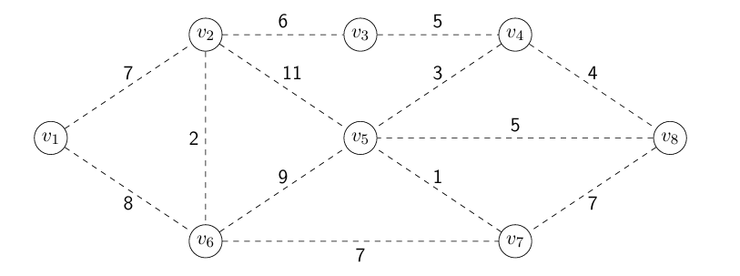
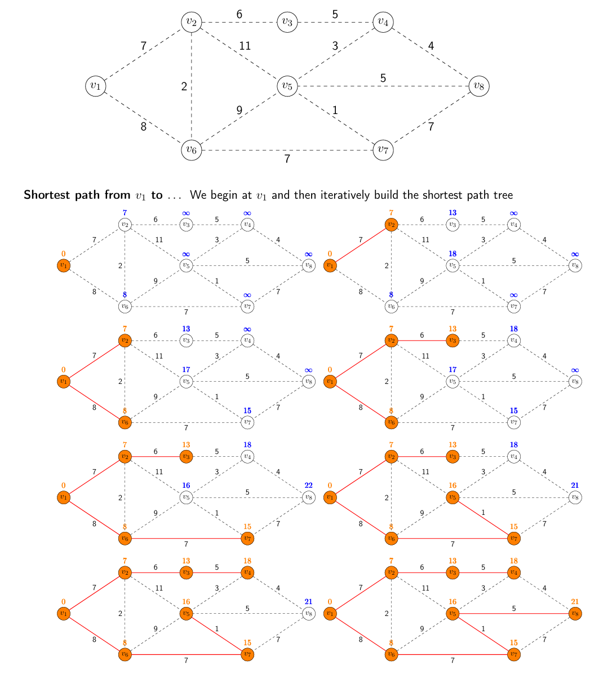

# Graph Algorithms, Greedy Graph Algorithms and Union Find

**Author:** Eric Zhou  
**Email:** <eric_ds_zhou@outlook.com>  
**Date:** Nov 07, 2026

## Introduction

This technical note summarizes the fundamental concepts, algorithms, and data structures used in graph algorithms, with a particular focus on greedy algorithms and Union-Find.

The note covers graph representations, minimum spanning trees, shortest paths, and Union-Find implementations. It also discusses the correctness of greedy algorithms through mathematical theorems and analyzes the time complexity of different implementations.

## Table of Contents

- Graph Algorithms
  - Basic Graph Concepts
  - Graph Representations
    - Adjacency Matrix
    - Adjacency List
  - Graph Properties and Lemmas
  - Algorithm Analysis
    - Basic Graph Traversal
    - Graph Algorithms with Priority Queue
- Minimum Spanning Tree (MST)
  - Definition
  - Prim's Algorithm
  - Kruskal's Algorithm
  - Lemmas and Theorems
  - Examples
  - Implementation and Complexity Analysis
- Shortest Paths
  - Definition
  - Shortest Path Theorems
  - Dijkstra's Algorithm
  - Examples
  - Implementation and Complexity Analysis
- Union-Find
  - Definition and Operations
  - Linked List Union-Find
    - Weighted Union
  - Tree-Based Union-Find
    - Weighted Union
    - Path Compression
  - Complexity Analysis
- Reference List

## Graph Algorithms

### Basic Graph Concepts

A **graph** is a fundamental data structure consisting of a set of vertices and a set of edges. A graph is typically represented as:

$$
G = (V, E)
$$

where:

- $V$: The set of vertices (nodes).
- $E$: The set of edges connecting vertices.
- $|V| = n$: The number of vertices.
- $|E| = m$: The number of edges.
- $G.V$: The vertex set of graph $G$.
- $G.E$: The edge set of graph $G$.

**Important Definitions:**

- **Adjacent:** Two vertices are adjacent if they share an edge.
- **Incident:** An edge $(v_i,v_j)$ is incident on both $v_i$ and $v_j$.
- **Degree:** The number of edges incident on a vertex, denoted by $\deg(v_i)$.
- **Directed Graph:** A graph in which edges have directions. An edge $(u,v)$ represents a connection from $u$ to $v$, but not necessarily from $v$ to $u$.
- **Complete Graph:** A simple graph in which every pair of distinct vertices is connected by an edge.
- **Spanning Tree:** A subgraph that contains every vertex and is both connected and acyclic.
- **Bridge:** An edge whose removal would disconnect the graph.
- **Walk:** A sequence of vertices in which consecutive vertices are connected by edges.
- **Path:** A walk in which all vertices are distinct.

### Graph Representations

There are two common ways to represent a graph: an **Adjacency Matrix** and an **Adjacency List**.

#### **1. Adjacency Matrix**

An adjacency matrix is a two-dimensional matrix $A$ where:

$$
A[i,j] =
\begin{cases}
1 & \text{if } (v_i,v_j)\in E \\
0 & \text{otherwise}
\end{cases}
$$

For an undirected graph, the adjacency matrix is symmetric.

- Space Complexity: $\Theta(n^2)$
- Edge Lookup: $\Theta(1)$

#### **2. Adjacency List**

An adjacency list stores the adjacent vertices of each vertex.

For example:

```text
Node: Edge1, Edge2...
v1: v2, v3
v2: v1, v3
v3: v1, v2
```

For an undirected graph, each edge appears in the adjacency lists of both endpoints.

- Edge Storage: $\Theta(m)$
- Total Space Complexity: $\Theta(n+m)$
- Edge Lookup: $O(\min(\deg(v_i),\deg(v_j)))$

**Comparison:**

| Property | Adjacency Matrix | Adjacency List |
| --- | --- | --- |
| Space | $\Theta(n^2)$ | $\Theta(n+m)$ |
| Edge Lookup | $\Theta(1)$ | $O(\min(\deg(v_i),\deg(v_j)))$ |
| Representation | 2D Matrix | Lists of Neighbors |

### Graph Properties and Lemmas

#### **1. Complete Graph**

For a complete undirected graph with $n$ vertices, every vertex is connected to the other $n-1$ vertices.

The number of edges is:

$$
|E| = (n-1)+(n-2)+\cdots+1
$$

Therefore:

$$
\boxed{|E| = \frac{n(n-1)}{2}}
$$

This gives an upper bound on the number of edges in a simple undirected graph.

#### **2. Handshaking Lemma**

The sum of the degrees of all vertices in an undirected graph is twice the number of edges.

$$
\boxed{\sum_{i=1}^{n}\deg(v_i)=2m}
$$

**Proof:**

Every edge is incident on exactly two vertices. Therefore, when summing the degrees of all vertices, every edge is counted twice.

Hence:

$$
\sum_{i=1}^{n}\deg(v_i)=2|E|=2m
$$

An important consequence is that the sum of all vertex degrees must be even.

#### **3. Properties of Trees**

For an undirected graph $G=(V,E)$, the following properties are equivalent:

- $G$ is a tree.
- Every pair of vertices is connected by a unique simple path.
- $G$ is connected, and every edge is a bridge.
- $G$ is connected and $|E|=|V|-1$.
- $G$ is acyclic and $|E|=|V|-1$.
- $G$ is acyclic, and adding any new edge between existing vertices creates a cycle.

These properties are especially useful when analyzing Minimum Spanning Trees.

### Algorithm Analysis

#### 1. Basic Graph Traversal

Consider the following algorithm on an undirected graph represented using adjacency lists.

**Pseudocode:**

```text
function Func(G)
    k = 0
    for each vertex vi in G.V do
        for each edge (vi, vj) incident on vi do
            k = k + 1
        end for
    end for
    return k
end function
```

**Time Complexity Analysis:**

Let $n$ be the number of vertices and $m$ be the number of edges.

The outer loop runs $n$ times.

For each vertex $v_i$, the inner loop runs $\deg(v_i)$ times.

Even if a vertex has degree zero, checking its adjacency list requires constant time.

Therefore:

$$
T(m,n)=\sum_{i=1}^{n}\left(c+\sum_{j=1}^{\deg(v_i)}c\right)
$$

Simplifying:

$$
T(m,n)=cn+c\sum_{i=1}^{n}\deg(v_i)
$$

By the Handshaking Lemma:

$$
\sum_{i=1}^{n}\deg(v_i)=2m
$$

Thus:

$$
T(m,n)=cn+2cm
$$

The final time complexity is:

$$
\boxed{T(m,n)\in\Theta(n+m)}
$$

**Return Value:**

Since each edge in an undirected graph is counted twice:

$$
\boxed{k=2m}
$$

This example demonstrates how the Handshaking Lemma can simplify the analysis of graph algorithms.

#### 2. Graph Algorithms with Priority Queue

This example extends the previous graph traversal analysis by introducing a **Min Priority Queue**.

Unlike the previous example, we must consider both the number of loop iterations and the time complexity of each Priority Queue operation.

**Pseudocode:**

```text
function Func(G)
    Q.Init()

    for each vertex vi in G.V do
        for each vertex vj in G.V do
            for each edge (vj, vk) incident on vj do
                Q.Insert(w(vi, vj))
            end for
        end for
    end for

    for each vertex vi in G.V do
        for each edge (vi, vj) incident on vi do
            x = Q.ExtractMin()
            Print x
        end for
    end for
end function
```

**Time Complexity Analysis:**

Let $n$ be the number of vertices and $m$ be the number of edges, where $m \ge n$.

Assume the Priority Queue is implemented using a **Min Heap**, where Insert and ExtractMin each take $O(\log s)$ time.

**Part 1: Insert Operations**

The outer loop runs $n$ times.

For each iteration, the inner two loops traverse all vertices and their incident edges.

By the Handshaking Lemma:

$$
\sum_{j=1}^{n}\deg(v_j)=2m
$$

Therefore, the total number of Insert operations is:

$$
n\sum_{j=1}^{n}\deg(v_j)=2nm
$$

The maximum heap size is:

$$
s=2nm
$$

Each Insert operation takes at most $O(\log(nm))$ time.

Therefore:

$$
T_{\text{Insert}}(n,m)=O(nm\log(nm))
$$

**Part 2: ExtractMin Operations**

The second group of nested loops traverses every vertex and its incident edges.

The total number of ExtractMin operations is:

$$
\sum_{i=1}^{n}\deg(v_i)=2m
$$

Each ExtractMin operation takes at most $O(\log(nm))$ time.

Therefore:

$$
T_{\text{ExtractMin}}(n,m)=O(m\log(nm))
$$

**Part 3: Total Time Complexity**

Combining the two parts:

$$
T(n,m)=O(nm\log(nm)+m\log(nm))
$$

Since $m\ge n$:

$$
\log(nm)=O(\log m)
$$

Therefore:

$$
\boxed{T(n,m)=O(nm\log m)}
$$

Under the standard binary Min Heap implementation, the total running time is more tightly bounded by:

$$
\boxed{T(n,m)\in\Theta(nm\log(nm))}
$$

Since $m\ge n$, this is equivalent to:

$$
\boxed{T(n,m)\in\Theta(nm\log m)}
$$

**Key Observation:**

For graph algorithms involving Priority Queues, the total time complexity depends on:

- The number of times each operation is executed.
- The time complexity of each operation.
- The size of the Priority Queue during execution.

Therefore, analyzing nested loops alone is not sufficient when the operations inside them have non-constant running times.

## Minimum Spanning Tree (MST)

### Definition

A **Spanning Tree** of a graph $G$ is a tree containing all vertices and some of the edges of $G$.

A **Minimum Spanning Tree (MST)** is a spanning tree of a connected, weighted, undirected graph that minimizes the total edge weight.

The weight of a spanning tree $T$ is defined as:

$$
weight(T)=\sum_{e\in T.E}weight(e)
$$

**Important Properties:**

- An MST contains all vertices of the graph.
- An MST is `connected` and `acyclic`.
- An MST with $n$ vertices contains exactly $n-1$ edges.
- An MST minimizes the total edge weight, rather than the distance from a particular starting vertex.
- A graph may have more than one MST.

Two common greedy algorithms for finding an MST are **Prim's Algorithm** and **Kruskal's Algorithm**.

### Prim's Algorithm

Prim's Algorithm constructs an MST by starting from a vertex and repeatedly adding the minimum-weight edge connecting the current tree to an undiscovered vertex.

**Greedy Strategy:**

At each iteration:

- Maintain a tree of discovered vertices.
- Consider all edges connecting discovered and undiscovered vertices.
- Select the edge with the minimum weight.
- Add the corresponding undiscovered vertex to the tree.
- Repeat until all vertices are discovered.

**Pseudocode:**

```text
function PrimMST(G)
    U = G.V - {v1}
    v1.MSTparent = NULL

    while U != empty and an edge exists from (G.V - U) to U do
        (vi, vj) = minimum weight edge from (G.V - U) to U
        vj.MSTparent = vi
        U = U - {vj}
    end while
end function
```

Here:

- $U$: The set of undiscovered vertices.
- $G.V-U$: The set of discovered vertices.
- $MSTparent$: The parent of a vertex in the MST.

The key idea is to select the **minimum-weight crossing edge**, not necessarily the minimum-weight edge in the entire graph.

### Kruskal's Algorithm

Kruskal's Algorithm constructs an MST by repeatedly selecting the minimum-weight edge that does not create a cycle.

Unlike Prim's Algorithm, Kruskal's Algorithm does not need a starting vertex.

**Greedy Strategy:**

- Initially, create a separate set for every vertex.
- Consider edges in nondecreasing order of weight.
- Add an edge if its endpoints belong to different sets.
- Union the sets containing the two endpoints.
- Continue until all vertices belong to one set.

**Pseudocode:**

```text
function KruskalMST(G)
    T = empty set

    for each vertex v in G.V do
        MakeSet(v)
    end for

    Sort all edges by nondecreasing weight

    for each edge (u, v) in sorted order do
        if FindSet(u) != FindSet(v) then
            T = T union {(u, v)}
            Union(u, v)
        end if
    end for

    return T
end function
```

**Key Observation:**

If two vertices already belong to the same set, adding an edge between them would create a cycle.

Therefore, Union-Find can be used to determine whether an edge can safely be added to the MST.

### Lemmas and Theorems

The correctness of Prim's greedy strategy can be established using the Minimum Spanning Tree Lemma and the Minimum Spanning Tree Theorem.

#### 1. Minimum Spanning Tree Lemma

Let $A$ be a spanning tree of graph $G$, and let $e_B$ be an edge of $G$ that is not in $A$.

The lemma states:

1. Adding $e_B$ to $A$ creates a cycle $C$.
2. Removing another edge $e_A$ from cycle $C$ produces another spanning tree.
3. If $weight(e_B)\le weight(e_A)$, the resulting spanning tree has weight no greater than $A$.

**Proof:**

**Part 1: Adding an Edge**

Since $A$ is a spanning tree, there is already a path connecting the endpoints of $e_B$.

Adding $e_B$ creates another connection between these endpoints, forming a cycle.

$$
A\cup\{e_B\}
$$

Therefore, a cycle $C$ is created.

**Part 2: Removing an Edge**

Remove an edge $e_A$ from the newly created cycle, where $e_A\ne e_B$.

$$
\boxed{B=(A\cup\{e_B\})-\{e_A\}}
$$

Removing an edge from the cycle breaks the cycle while preserving connectivity.

Therefore, $B$ is still a spanning tree.

**Part 3: Comparing Weights**

If:

$$
weight(e_B)\le weight(e_A)
$$

Then:

$$
weight(B)=weight(A)+weight(e_B)-weight(e_A)
$$

Therefore:

$$
\boxed{weight(B)\le weight(A)}
$$

This proves that replacing an edge with another edge of equal or smaller weight does not increase the total weight of the spanning tree.

#### 2. Minimum Spanning Tree Theorem

Let $T$ be a subtree of a Minimum Spanning Tree.

If $e$ is a minimum-weight edge connecting $T$ to a vertex outside $T$, then:

$$
\boxed{T\cup\{e\}}
$$

is also a subtree of some Minimum Spanning Tree.

**Proof:**

Let $A$ be an MST containing $T$, and let $e$ be the minimum-weight edge connecting $T$ to a vertex outside $T$.

There are two possible cases.

**Case 1: $e\in A$**

If $e$ is already in $A$, adding $e$ to $T$ preserves the property that $T$ is a subtree of an MST.

Therefore, the theorem holds.

**Case 2: $e\notin A$**

Since $A$ is a spanning tree, adding $e$ creates a cycle $C$.

According to the MST Lemma, we can remove another edge $e_A$ from this cycle and obtain another spanning tree:

$$
B=(A\cup\{e\})-\{e_A\}
$$

Choose $e_A$ as another edge connecting $T$ to a vertex outside $T$.

Since $e$ is the minimum-weight edge connecting $T$ to the outside:

$$
weight(e)\le weight(e_A)
$$

Therefore:

$$
weight(B)\le weight(A)
$$

However, $A$ is already a Minimum Spanning Tree. No spanning tree can have a smaller total weight.

Thus:

$$
\boxed{weight(B)=weight(A)}
$$

Therefore, $B$ is also an MST, and it contains $T\cup\{e\}$.

This proves that selecting the minimum-weight crossing edge is a safe greedy choice.

**Key Observation:**

The MST Lemma provides the edge exchange property, while the MST Theorem uses this property to prove the correctness of Prim's greedy strategy.

### Examples

Consider the weighted graph from Professor Painter's lecture notes.



Starting from vertex $v_1$, Prim's Algorithm selects the following edges:

| Step | Selected Edge | Weight |
| --- | --- | --- |
| 1 | $(v_1,v_2)$ | 7 |
| 2 | $(v_2,v_6)$ | 2 |
| 3 | $(v_2,v_3)$ | 6 |
| 4 | $(v_3,v_4)$ | 5 |
| 5 | $(v_4,v_5)$ | 3 |
| 6 | $(v_5,v_7)$ | 1 |
| 7 | $(v_4,v_8)$ | 4 |

The total weight is:

$$
weight(T)=7+2+6+5+3+1+4
$$

Therefore:

$$
\boxed{weight(T)=28}
$$

The resulting MST contains all eight vertices and seven edges.


**Prim vs. Kruskal:**

| Property | Prim | Kruskal |
| --- | --- | --- |
| Starting Vertex | Required | Not Required |
| Greedy Choice | Minimum crossing edge | Minimum eligible edge |
| Cycle Prevention | Adds an undiscovered vertex | Checks disjoint sets |
| Main Data Structure | Min Priority Queue | Union-Find |
| Construction | Grows one tree | Merges separate components |

### Implementation and Complexity Analysis

#### 1. Basic Prim Implementation

In the basic implementation, we repeatedly search all edges to find the minimum-weight edge connecting discovered and undiscovered vertices.

Let:

- $n$: Number of vertices.
- $m$: Number of edges.

The algorithm adds approximately $n$ vertices to the spanning tree.

At each iteration, finding the minimum crossing edge may require examining all $m$ edges.

Therefore:

$$
T(n,m)=\Theta(nm)
$$

Thus:

$$
\boxed{T(n,m)\in\Theta(nm)}
$$

#### 2. Improved Prim Implementation

Instead of searching all edges repeatedly, we store the current minimum edge weight for every undiscovered vertex.

Each vertex maintains:

- `cost`: The minimum edge weight connecting it to the discovered tree.
- `parent`: The discovered vertex providing that minimum edge.

**Pseudocode:**

```text
function PrimMST(G)
    U = G.V

    for each vertex vi in G.V - {v1} do
        vi.cost = infinity
    end for

    v1.cost = 0
    v1.parent = NULL

    while U is not empty and some vertex in U has finite cost do
        vj = vertex in U with minimum cost
        U = U - {vj}

        vj.MSTparent = vj.parent

        for each edge (vj, vk) incident on vj do
            if vk in U and weight(vj, vk) < vk.cost then
                vk.parent = vj
                vk.cost = weight(vj, vk)
            end if
        end for
    end while
end function
```

**Time Complexity Analysis:**

Finding the vertex with minimum cost requires scanning the undiscovered vertices.

The total cost is:

$$
\sum_{i=1}^{n}i=\frac{n(n+1)}{2}
$$

Therefore:

$$
T_{\text{Selection}}=\Theta(n^2)
$$

For the adjacency list traversal, the Handshaking Lemma gives:

$$
\sum_{i=1}^{n}\deg(v_i)=2m
$$

Thus:

$$
T_{\text{Edges}}=\Theta(m)
$$

Combining the two:

$$
\boxed{T(n,m)\in\Theta(n^2+m)}
$$

#### 3. Prim Implementation with Min Heap

We can further improve Prim's Algorithm using a **Min Priority Queue** implemented with a Min Heap.

Assume the following operations:

| Operation | Time Complexity |
| --- | --- |
| Insert | $\Theta(\log s)$ |
| ExtractMin | $\Theta(\log s)$ |
| DecreaseKey | $\Theta(\log s)$ |
| Contains | $\Theta(1)$ |
| MinKey | $\Theta(1)$ |

Here, $s$ represents the number of elements in the heap.

**Pseudocode:**

```text
function PrimMST(G)
    Q.Init()

    for each vertex vi in G.V - {v1} do
        Q.Insert(vi, infinity)
    end for

    Q.Insert(v1, 0)
    v1.parent = NULL

    while Q.IsNotEmpty() and Q.MinKey() != infinity do
        vj = Q.ExtractMin()
        vj.MSTparent = vj.parent

        for each edge (vj, vk) incident on vj do
            if Q.Contains(vk) and weight(vj, vk) < Q.Key(vk) then
                vk.parent = vj
                Q.DecreaseKey(vk, weight(vj, vk))
            end if
        end for
    end while
end function
```

**Time Complexity Analysis:**

**Part 1: Insert Operations**

We insert $n$ vertices into the Min Heap.

The total cost is:

$$
T_{\text{Insert}}(n)=\sum_{s=1}^{n}\Theta(\log s)
$$

Therefore:

$$
T_{\text{Insert}}(n)\in\Theta(n\log n)
$$

**Part 2: ExtractMin Operations**

Every vertex is extracted from the heap once.

The total cost is:

$$
T_{\text{ExtractMin}}(n)=\sum_{s=1}^{n}\Theta(\log s)
$$

Therefore:

$$
T_{\text{ExtractMin}}(n)\in\Theta(n\log n)
$$

**Part 3: Edge Updates**

For each extracted vertex $v_j$, the algorithm examines its incident edges.

Each iteration may perform a DecreaseKey operation.

Since the heap contains at most $n$ elements:

$$
T_{\text{Updates}}
\le O\left(\sum_{j=1}^{n}\deg(v_j)\log n\right)
$$

By the Handshaking Lemma:

$$
\sum_{j=1}^{n}\deg(v_j)=2m
$$

Therefore:

$$
T_{\text{Updates}}=O(m\log n)
$$

**Part 4: Total Complexity**

Combining all operations:

$$
T(n,m)=O(n\log n+n\log n+m\log n)
$$

Thus:

$$
\boxed{T(n,m)\in O(n\log n+m\log n)}
$$

This is an upper bound, following the analysis in Professor Painter's lecture notes.

**Comparison of Prim Implementations:**

| Implementation | Main Idea | Time Complexity |
| --- | --- | --- |
| Basic Prim | Scan all edges at each iteration to find the minimum-weight crossing edge. | $\Theta(nm)$ |
| Improved Prim | Store the minimum `cost` for each undiscovered vertex. After adding a new vertex, compare its incident edges with the stored costs and update them if a smaller weight is found. | $\Theta(n^2+m)$ |
| Min Heap Prim | Initialize all vertices in a Min Heap with `cost = ∞`, except the starting vertex with `cost = 0`. Repeatedly use `ExtractMin()` to select the vertex with the smallest cost, then use `DecreaseKey()` to update its undiscovered neighbors if a smaller weight is found. | $O(n\log n+m\log n)$ |

The Min Heap implementation can be more efficient for sparse graphs, while the $\Theta(n^2+m)$ implementation can be preferable for dense graphs.



## Reference List

1. *"CSE2331_Midterm_5_Review"* Created by Professor Painter.
2. *"CSE2331_Midterm_5_Review_Session"* Created by Professor Painter.
3. *"CSE2331_Graph_Algorithms_Homework"* Created by Professor Painter.
4. *"CSE2331_Graph_Algorithms_Tree_Typed"* Created by Professor Painter.
5. *"CSE2331_Minimum_Spanning_Tree_Typed"* Created by Professor Painter.
6. *"CSE2331_Shortest_Path_Typed"* Created by Professor Painter.
7. *"CSE2331_Union_Find_Typed"* Created by Professor Painter.
